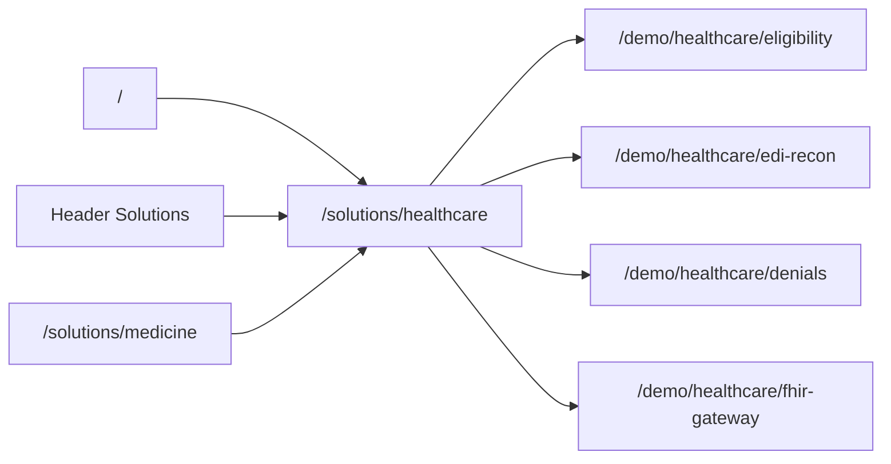

# Healthcare 10-Product Demo Modules

## What the site already has

The Next.js 16 app in [`agintx-site`](agintx-site) is a dark, enterprise marketing site:

- **Live routes:** `/` (hero, 5-step workflow, feature bento, demo CTA), `/platform`, `/pricing`, `/docs`, `/demo` (lead form + [`/api/demo-request`](agintx-site/src/app/api/demo-request/route.ts))
- **Nav:** Platform, Pricing, Docs + Request Demo / Get Started ([`Header.tsx`](agintx-site/src/components/Header.tsx))
- **Unused data:** [`src/data/verticals.ts`](agintx-site/src/data/verticals.ts) defines **16 industry verticals** (banking, insurance, payments, medicine, etc.) with headlines, use cases, SDK snippets, and testimonials — **nothing imports it**. No `/solutions` or `/[vertical]` pages exist.
- **Medicine today:** one generic `med-agintx` story (prior auth, SOAP notes, care gaps). It does **not** match the 10 productized healthcare payments/interop workflows in the PDF.
- **Demo today:** a sales form, not a product sandbox.

The PDF (*Agintx Healthcare Scale: 10 Payments & Integration Products*) is a **healthcare product line** on a shared UHIC core (Epic/Cerner/Allscripts + clearinghouses, BAA, SOC2), not the 16-industry catalog.

## Architecture

- **Shared UHIC demo shell:** one layout (banner “Demo environment · synthetic data · not PHI”), stepper of the agent workflow, left “inputs”, right “agent trace + result”, footer CTA to `/demo?product=...`.
- **Canned data only:** JSON fixtures in [`agintx-site/src/data/healthcare-demos/`](agintx-site/src/data/healthcare-demos/). Client-side state machines. No real EDI/FHIR/payers, no PHI.
- **New content file:** `src/data/healthcare-products.ts` — the 10 products (slug, domain, killer workflow, ACV, demo steps, fixtures). Keep [`verticals.ts`](agintx-site/src/data/verticals.ts) for a later industry hub; optionally add a “10 payments products” link on the medicine vertical page.

## Site linking (main website)

- Add **Solutions** to [`Header.tsx`](agintx-site/src/components/Header.tsx) and [`Footer.tsx`](agintx-site/src/components/Footer.tsx) → `/solutions/healthcare` (dropdown later if more verticals go live).
- Homepage: new “Healthcare payments & interop” strip after the workflow section — 10 compact cards linking to each demo; primary CTA “Launch healthcare demos”.
- Platform page: UHIC callout (HIPAA/BAA/SOC2, Epic/Cerner/Allscripts adapters) linking to the hub.
- Docs: one “Healthcare UHIC” card linking to the hub (no fake API docs yet).
- Wire unused [`verticals.ts`](agintx-site/src/data/verticals.ts) **minimally** for medicine: `/solutions/medicine` that redirects or nests into the healthcare hub so the existing content is not wasted.

## Shared demo UI (build once)

Files:

- `src/app/solutions/healthcare/page.tsx` — thesis + 10 product grid (domain, workflow, ACV, Launch demo)
- `src/app/demo/healthcare/[slug]/page.tsx` — dynamic demo
- `src/components/demo/DemoShell.tsx` — layout, synthetic-data banner, step runner
- `src/components/demo/AgentTrace.tsx` — simulated tool calls (eligibility, 837, FHIR, etc.)
- `src/data/healthcare-products.ts` + per-product fixtures

Each demo: **Run agent** → animated trace (1–2s) → structured result panel → “Request live demo” prefilled with product slug.

## Per-module demo plan

Each module: 3–5 canned scenarios, one primary happy path, one exception path.

1. **Hospitals — Real-Time Eligibility & Cost-Estimator** (`eligibility`)  
   Input: synthetic patient + payer + CPT. Output: coverage, copay/coinsurance, patient-pay estimate, agent audit id. Exception: inactive coverage.

2. **Ambulatory — EDI 837/835 Reconciliation** (`edi-recon`)  
   Input: claim batch vs ERA. Output: matched / unmatched / underpaid lines, variance $. Exception: missing 835.

3. **Billing companies — Denied Claims Appeal Pipeline** (`denials`)  
   Input: denial reason (CO-16, CO-50, etc.). Output: appeal letter draft, missing-docs checklist, resubmit packet. Exception: timely-filing dead.

4. **Telehealth — Cross-State Payment & Ledger Sync** (`telehealth-ledger`)  
   Input: visit in state A, patient in state B, two currencies. Output: tax/nexus note, ledger entries, settlement status. Exception: license not valid in visit state.

5. **Labs — HL7/FHIR Result → Charge Capture** (`lab-charge`)  
   Input: FHIR DiagnosticReport / HL7 ORU. Output: CPT/charge lines, missing-order flags. Exception: unsolicited result, no accession.

6. **Specialty pharmacy — Benefit Investigation & Copay Orchestrator** (`pharmacy-bi`)  
   Input: NDC + insurance. Output: PA needed?, copay card stack, patient out-of-pocket. Exception: copay card exhausted.

7. **DSOs — X-Ray Attachment & Fast-Track Claims** (`dental-claims`)  
   Input: CDT + attachment presence. Output: attachment completeness, predicted adjudication days. Exception: missing bitewing.

8. **Value-based care — Multi-Payer Risk Aggregation** (`vbc-ledger`)  
   Input: member panel + 2–3 payers. Output: RAF snapshot, gap list, shared ledger. Exception: stale HCC.

9. **Behavioral health — Superbill + OON Tracker** (`behavioral-superbill`)  
   Input: session notes (synthetic). Output: superbill (CPT/ICD), OON reimbursement status. Exception: missing start/stop times.

10. **Payers — FHIR Interop Mandate Gateway** (`fhir-gateway`)  
    Input: Patient Access / Provider Directory request. Output: FHIR Bundle, consent/scope check, latency. Exception: missing patient consent.

## Out of scope

- Real UHIC adapters, BAAs, or live APIs
- Wiring all 16 industry verticals as demos (data stays for a later Solutions index)
- Privacy/terms/security pages (still dead in footer)

## Verification

Exercise hub → each of 10 demos (run + exception) → homepage/nav/footer links → medicine nest → demo CTA query param on `/demo`.
